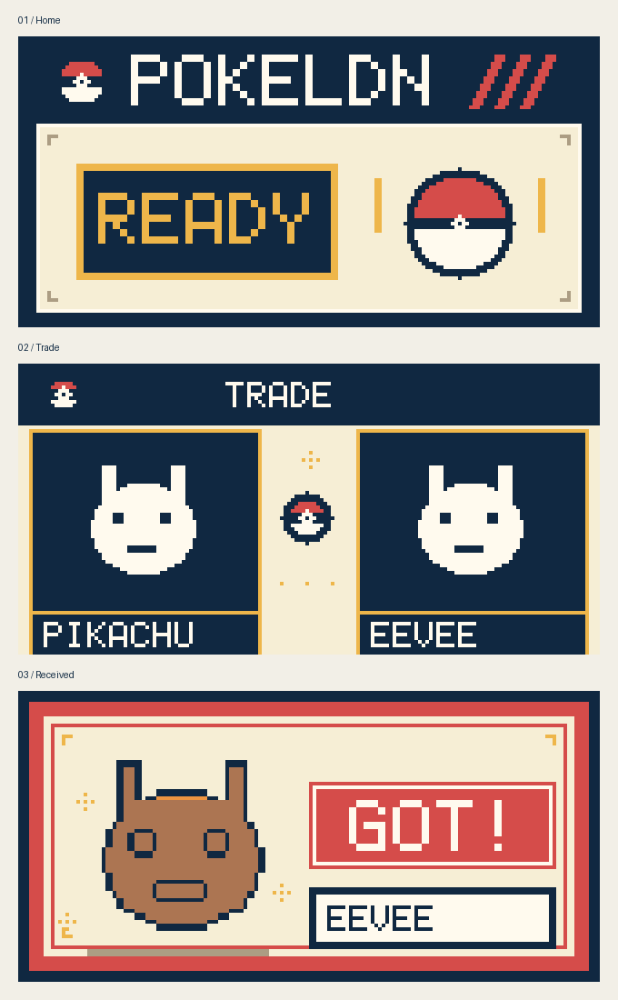

# PokéLDN Pocket Calm — T-Dongle S3, v0.6



**Unofficial community firmware** for the **original LILYGO T-Dongle S3**, featuring its built-in **160×80 ST7735S screen**. Works with the existing PokéLDN Windows application; no modifications to its USB protocol are required.

**Not affiliated with the PokéLDN developers, Nintendo, The Pokémon Company, LILYGO or Espressif.**

## Download and install (Windows 10/11, x64)

Download **`PokeLDN-PocketCalm-v0.6-Installer.exe`** from the [GitHub Releases](../../releases/latest) section (or from the workflow's **Artifacts** if a Release hasn't been published yet). Do not download the source ZIP if you just want to install the firmware.

1. Connect the original **LILYGO T-Dongle S3** to your Windows PC.
2. **Close PokéLDN** and other programs using the dongle's serial port.
3. Open the EXE. Click **Detect ports**, or type the port seen under *Device Manager → Ports (COM & LPT)*.
4. Check that the device is the correct board, then click **Install v0.6** and confirm.
5. Do not disconnect USB or close the installer until it says **Firmware installed successfully!**.
6. Unplug/reconnect the dongle and start PokéLDN again.

The installer automatically provides the full firmware and **Espressif esptool**. No Python, ESP-IDF or compiler is required for users. It does not require administrator privileges under normal USB driver configurations.

**Important:** Flashing replaces whatever firmware is currently installed. The installer checks for an **ESP32-S3**, but cannot prove that the connected device is the specific LILYGO board: verify that yourself. Do not use on other ESP32-S3 boards with different GPIO wiring. The installer does not erase the entire flash chip, but may overwrite existing bootloader, partition table and app areas. Keep a backup of other custom firmware before installing.

### If no COM port is found

Install the relevant Windows USB driver if required, then look in **Device Manager → Ports**. If the ESP32-S3 does not respond, try holding the board's **BOOT** button while connecting to USB, then detect the new COM port. If PokéLDN is open, close it before flashing.

### Features

- Familiar handheld-inspired UI, in **English**.
- High-contrast **monochrome Pokémon sprites** during trades, matching v0.1-style source pixels.
- Two Pokémon appear at the sides with a **flying Poké Ball** animation at the center.
- Softer APA102 LED: **slow cyan breath** during trades, **gentle green** after Pokémon reception, reduced brightness at idle.
- Compatible with PokéLDN's existing radio/USB messages.

## Building the Windows installer (for maintainers)

This repository intentionally contains **no precompiled firmware**: GitHub Actions creates it from source. The build is reproducible in a CI environment, avoiding IDE setup for your community.

1. Push all files to a public GitHub repository (include `.github/workflows/build-windows-installer.yml`).
2. Open **Actions → Build portable Windows firmware installer → Run workflow**. Pushing to `main` triggers it automatically too.
3. Wait for the **build** job to succeed. Download the artifact `PocketCalm-v0.6-Windows-Installer` to obtain the complete `.exe`.
4. To publish it under **Releases**, create a tag like `v0.6.0` and push it: the workflow also creates the release entry and attaches the EXE.

The CI job:

- installs ESP-IDF **v6.1** with Espressif's official GitHub Action;
- builds this repository's **ESP32-S3** firmware with `POKELDN_DISPLAY=T_DONGLE_S3`;
- reads ESP-IDF's **actual `flasher_args.json`** to create one merged firmware file, including bootloader, partition table and app;
- fetches **esptool 5.6.0** from Espressif's official release and embeds it with the firmware in a single native **Windows .exe**;
- cross-compiles the installer using Go with **no third-party Go dependencies**;
- uploads the Windows EXE as a downloadable artifact and, for version tags, a GitHub Release.

The GitHub Action has been prepared but **has not yet been run in a live GitHub repository**. Please run it and check its build logs before telling others the release is ready.

### Firmware build from an ESP-IDF v6.1 terminal

The original `build_tdongle_windows.ps1` is retained for firmware developers. To build/flash from an ESP-IDF PowerShell terminal:

```powershell
.\build_tdongle_windows.ps1
.\build_tdongle_windows.ps1 -Port COM5 -Flash
```

### Installer build from source

The installer lives at `flasher/main_windows.go`. It uses Go standard library Win32 calls. Assets under `flasher/assets/` are generated by the CI job. Do not attempt to distribute a locally compiled installer with placeholder assets: it will refuse to flash.

## Licensing and provenance

The project's original firmware sources are based on the upstream [PokéLDN radio firmware](https://github.com/Decryptu/pokeldn) and use **AGPL-3.0**; the original text is in `LICENSE`. `vendor/zstd` retains its separate upstream licence in `vendor/zstd/LICENSE`. Espressif's `esptool` is bundled from an [official upstream release](https://github.com/espressif/esptool/releases) when CI runs; consult its licence and source repository. No Nintendo trademarks, artwork or logos are licensed or endorsed by the companies named above.

The firmware displays monochrome sprite data received from PokéLDN. This repository does not include a collection of proprietary Pokémon artwork.

## Theme lab (no flashing required)

Open `theme-lab.html` locally in any browser to compare **five palettes** across Home, Trade and Received screens: Classic v0.6, Modern Minimal, Game Boy Color, Crimson Ruby and Ocean Teal. These images are recoloured directly from the existing v0.6 display renders, preserving the 160×80 geometry and sprite pixels. They are **previews only**, not firmware files.

## Next design experiments

The public v0.6 is a stable baseline. UI theme experiments should remain on development branches, with USB protocol and radio features unchanged, until they have been tested on the physical display.
