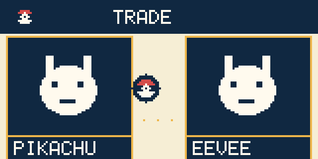
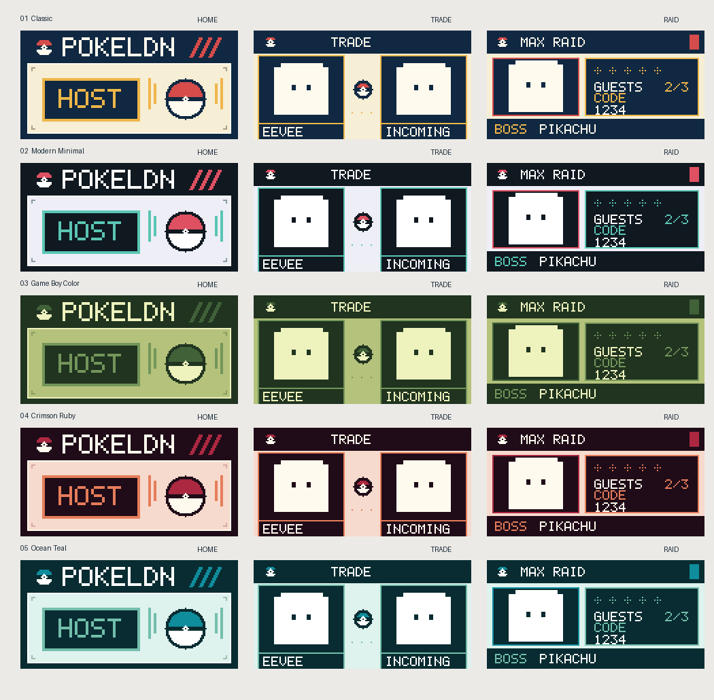
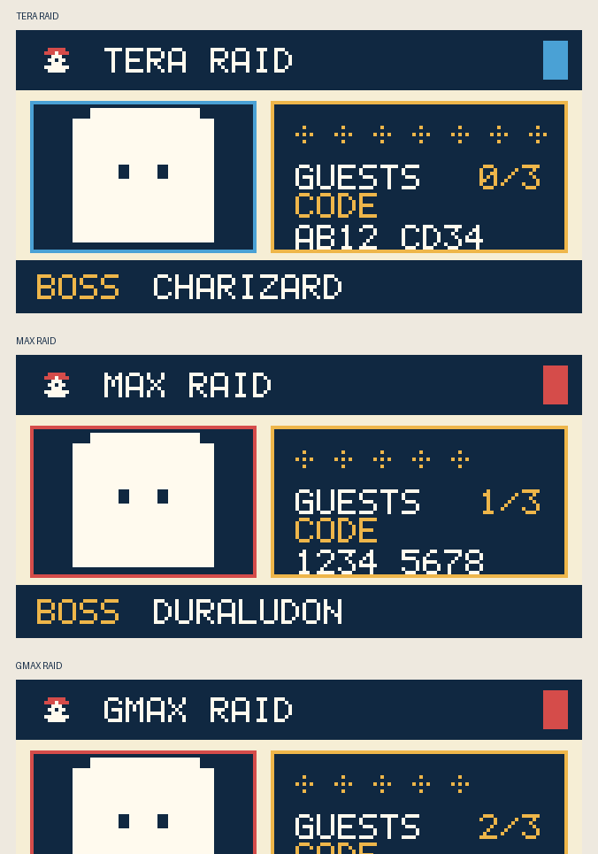
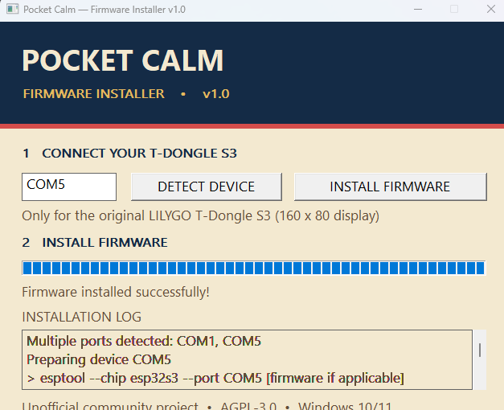

# PokéLDN Pocket Calm

**A tiny screen. A better trading experience.**

Custom display firmware and a one-file Windows installer for the **original LILYGO T-Dongle S3** (ESP32-S3 · 160 × 80 LCD).

### [Download for Windows](https://github.com/Arbusys/PokeLDN-PocketCalm/releases/latest) · [Installation guide](docs/INSTALLATION.md) · [Troubleshooting](docs/TROUBLESHOOTING.md)

*Unofficial community project. Not affiliated with or endorsed by the PokéLDN team, Nintendo, The Pokémon Company, LILYGO or Espressif.*

---

## Your trades, on the dongle

Pocket Calm uses the T-Dongle S3's built-in colour screen to show PokéLDN activity without changing the existing Windows application. Watch **two large monochrome Pokémon silhouettes** and an animated **flying Poké Ball** during exchanges; see a confirmation when a Pokémon arrives.

  
   Renderer preview — enlarged from the device's 160 × 80 display.

## Five themes, one button

 Software-rendered previews. Actual LCD colours may vary.

| Theme | Character |
|:--|:--|
| **Classic** | Handheld-inspired navy, warm cream and red |
| **Modern Minimal** | Restrained charcoal and turquoise |
| **Game Boy Color** | Nostalgic green-toned palette |
| **Crimson Ruby** | Deep wine and warm accents |
| **Ocean Teal** | Cool blue-green with soft highlights |

Press the **rear BOOT button briefly after startup** to switch themes. Pocket Calm remembers your selection after unplugging the dongle. **Do not hold BOOT while connecting USB**, as that can enter ESP32 download mode.

## Raid lobbies, too

 Illustrative test data, not live raid captures.

The display supports hosted raid-lobby information **when the unmodified PokéLDN desktop application sends it**: available boss sprite and name, stars, guests and link code. Where the transmitted title identifies a format, the header can show **TERA RAID**, **MAX RAID**, **GMAX RAID** or **DYNAMAX ADV**. Otherwise it safely shows **RAID LOBBY**.

Pocket Calm does **not** invent untransmitted data such as Tera type, battle timers, victory state, or a Gigantamax form that the event does not distinguish.

## A calmer, smarter indicator

- **Trades:** slower, softer cyan LED breathing effect.
- **Received Pokémon:** gentle green confirmation.
- **Idle:** dimmer LED and fewer unnecessary screen/LED updates.
- **Themes:** saved locally on the device; no desktop configuration utility needed.

These optimisations reduce unnecessary activity, but actual temperature and power usage depend on the board and operating conditions.

## Install in minutes — no developer tools

 Installer screenshot from a hardware test.

1. Download **`PokeLDN-PocketCalm-v1.0-Installer.exe`** from [Releases](https://github.com/Arbusys/PokeLDN-PocketCalm/releases/latest) (open **Assets**).
2. Plug in the **original T-Dongle S3 with the 160 × 80 display** using USB.
3. **Close PokéLDN** and any serial tools. Open the installer.
4. Check the automatically detected COM port and target board, then choose **INSTALL FIRMWARE**.
5. Wait for **Firmware installed successfully!**; reconnect the dongle, then open PokéLDN.

No ESP-IDF, Python, compiler or separate `esptool` installation is needed for end users. The `.exe` contains the required flashing components.

> [!CAUTION]
> Flashing replaces firmware on the connected device. **Use only the original LILYGO T-Dongle S3 with the integrated 160 × 80 LCD.** Detection can recognise ESP32-S3 hardware but **cannot guarantee the exact board model**. Confirm the board before installing, and keep a backup of any firmware you want to preserve.

Read the [step-by-step installation guide](docs/INSTALLATION.md) if you are new to ESP32 devices. If automatic detection fails, use [Troubleshooting](docs/TROUBLESHOOTING.md).

## Compatibility

| Component | Support |
|:--|:--|
| Hardware | Original **LILYGO T-Dongle S3**, integrated 160 × 80 LCD |
| Host | **Windows 10/11**, 64-bit |
| PokéLDN desktop | Existing Windows application; **no desktop patch required** |
| Trade animations | Pokémon silhouettes, flying Poké Ball, arrival feedback |
| Hosted raids | Existing PokéLDN `LOBBY` / `JOINED` display events, when sent |
| Theme switch | Rear BOOT button; preference persists across power cycles |

**Test status:** the maintainer has exercised flashing, PokéLDN recognition, theme switching/persistence, and relevant display features on a real T-Dongle S3. Testing across other computers and hardware batches is welcome. This is not an official hardware certification.

## Docs & development

- [Installation](docs/INSTALLATION.md) · [Troubleshooting](docs/TROUBLESHOOTING.md)
- [Build from source / maintainer notes](docs/BUILDING.md)
- [Project credits & licences](docs/CREDITS.md)
- [Changelog](CHANGELOG.md) · [Release notes](RELEASE_NOTES.md)
- Open `theme-lab.html` in your browser to explore palette mockups without flashing anything.

Pocket Calm is based on the [PokéLDN firmware project](https://github.com/Decryptu/pokeldn) and distributed under the [AGPL-3.0](LICENSE); component-specific third-party notices are preserved in the repository. Source for each release is available under the matching Git tag. Firmware and installer are provided **as is**, without warranty.

**Pocket Calm is not the PokéLDN application.** Get PokéLDN itself at [pokeldn.app](https://pokeldn.app/).
